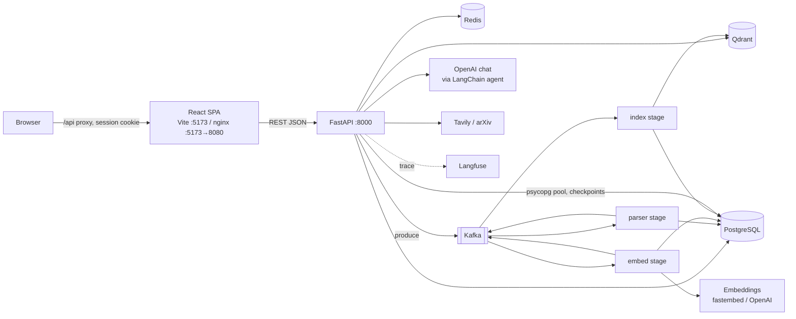

# System Architecture

> Owner: `system-architect` · Canonical design rationale: [`docs/RAG_ARCHITECTURE.md`](../RAG_ARCHITECTURE.md), [`docs/KAFKA_INGESTION.md`](../KAFKA_INGESTION.md), [`docs/EMBEDDING_AND_COLLECTIONS.md`](../EMBEDDING_AND_COLLECTIONS.md); code-level details: [`docs/ARCHITECTURE.md`](../ARCHITECTURE.md#backend).
> This doc holds only the overall map and principles. When the structure changes, update this doc and [DECISION_LOG.md](DECISION_LOG.md) together.

## Overall structure

The three stages run as three consumer groups (`parser-workers`, `embed-workers`, `index-workers`) inside one process, `workers.ingest_worker`.

## Components and responsibilities

| Component | Responsibility | Notes |
|---|---|---|
| Frontend (`frontend/`) | UI, React Query cache, API layer `src/lib/api/` | Same-origin via the Vite proxy (dev) or nginx (Docker) |
| API (`backend/app`) | Auth, collection/document/chat/usage APIs, agent execution, `/metrics` | Only produces to Kafka, never consumes |
| Ingest worker (`workers/ingest_worker.py`) | parser → embed → index, a 3-stage async pipeline | Must be running for documents to reach `INDEXED` |
| PostgreSQL | Users, sessions, CollectionMeta, chats, progress, logs, pricing; LangGraph checkpoints | Alembic (`migrations/versions/` is gitignored). Two client pools per API process: SQLAlchemy asyncpg (default 5+10, `dependencies/db.py`) and psycopg for the checkpointer (max 10, `dependencies/clients.py::get_checkpointer`). Checkpoint tables are created by `AsyncPostgresSaver.setup()` in lifespan, excluded from Alembic (`migrations/env.py`) |
| Qdrant | Chunk vectors (dense + optional BM25 sparse), `document_id` in payload | Hybrid search with RRF fusion |
| Redis | Client singleton warmed/closed in lifespan | No application reads or writes (confirmed T-036) |
| Kafka | Message bus between ingest stages | Topic design: RAG_ARCHITECTURE.md §4 |
| Monitoring (`monitoring-docker-compose.yaml`) | Prometheus, Grafana, exporters, cAdvisor, Loki + Alloy | Separate compose project on the infra network (D-012) |

Compose layout: `system-docker-compose.yaml` (infra, project `rag_chatbot_system`), `service-docker-compose.yaml` (api, frontend, ingest-worker; non-root), `monitoring-docker-compose.yaml`. Both service and monitoring join the external network `rag_chatbot_system_default`.

## Data flow

**Write (ingest):** `POST /collections/{name}/documents` → produce `documents.uploaded` → return 202 → parser stage (chunking) → embed stage (embedding) → index stage (Qdrant upsert) → status `INDEXED` + `DocumentManageLog`.

**Read (chat):** `POST /chats/{id}/messages` → ownership check → commit user message to `chat_messages` → build the tool list per request (tools close over the request `AsyncSession`) → `create_agent(..., middleware=[SummarizationMiddleware], checkpointer=AsyncPostgresSaver)` → `ainvoke` with only the new query, `thread_id = chat_id` (recursion limit 20) → slice the current turn → answer + citations → commit assistant message → `chat_usage_logs` + `agent_tool_call_logs`. Non-streaming.

**Conversation state lives in two places:** `chat_messages` (user/assistant text + citations; written per turn, currently read by no API) and LangGraph checkpoints (full agent state incl. tool calls/results and the running summary; what the model actually sees). Summarization triggers at 4000 tokens, keeps 6 messages, uses the chat's own model, and its tokens are not in `chat_usage_logs`. No compensation on failure in either store; no per-chat lock; checkpoints are never pruned. See T-036 findings below.

**Auth:** Google OAuth → opaque token in `google_sessions` (14-day TTL, `session` cookie, httponly, SameSite=Lax). Each authenticated request looks the session up twice (`ApiCallLogMiddleware` + `get_current_user`) plus a `users` read. Expired rows are never deleted.

**Frontend chat:** `useChat` keeps messages in React state only; `chatId` is created lazily on first send and lost on reload (no list/history endpoints exist). One in-flight send per tab (`mutation.isPending`).

**Search:** embed the query with the collection's fixed embedding model → Qdrant: dense+sparse prefetch then RRF when sparse is configured, otherwise dense only → top-k 8.

## Main tables

`users`, `google_sessions`, `collection_meta`, `chats`, `chat_messages`, `document_progress_status`, `document_manage_logs`, `chat_usage_logs`, `agent_tool_call_logs`, `model_pricing`; outside Alembic: `checkpoints`, `checkpoint_writes`, `checkpoint_blobs`, `checkpoint_migrations`. No table has a retention policy. API call logs are log lines (Loki, 7d), not a table.

## Design principles

1. **Fixed layering:** endpoint → service → repository → client. Services and repositories are `@lru_cache` `get_*` singletons with constructor injection.
2. **One embedding model per collection:** ingestion and search both use the model fixed in `CollectionMeta`.
3. **Async writes, sync reads:** ingestion via Kafka, chat request-response (RAG_ARCHITECTURE.md §2.2).
4. **Exceptions raised in services/repositories, converted by a global handler:** no per-endpoint try/except.
5. **Logs only in the service/worker layer**; a per-request `api_call_id` is injected into every log line.
6. **Least privilege for agent tools:** no code execution, no free-form SQL ([DECISION_LOG.md](DECISION_LOG.md) D-003, D-004).
7. Optional external features (Tavily, Langfuse) silently disable without keys; not an error.

## Known structural constraints

See [KNOWN_ISSUES.md](KNOWN_ISSUES.md) (no compensating transaction, non-streaming, etc.).

Load-test scenarios and capacity hypotheses (DB pool / local embedding CPU): [`loadtest/SCENARIOS.md`](../../loadtest/SCENARIOS.md) (D-010).

## Structural risks (T-036 review, code reading, not measured)

Assumption: 10k DAU, 5 turns/user/day = 50k turns/day, peak 3x avg ≈ 2 turns/s, 5-20 s per turn → ~40 turns in flight (Little's law).

1. **Failed turn can brick a chat:** a tool exception or `GraphRecursionError` leaves an `AIMessage` with unanswered `tool_calls` in the checkpoint (`ToolNode` re-raises non-validation errors); the next turn sends that to OpenAI, which rejects it, on every later turn. The `chat_messages` user row also stays (KI-001).
2. **Parallel tool calls share one `AsyncSession`:** `ToolNode` runs a turn's tool calls with `asyncio.gather`; retrieval and usage-stats tools both use the request session (`services/agent/tools.py:71,92,142`) → concurrent-operation errors when the model searches two collections at once.
3. **DB connection held across LLM calls** (KI-010): ~15 concurrent turns per API process before pool timeouts.
4. **Checkpoint growth:** default `durability="async"` writes a checkpoint (full `messages` blob) per super-step and never prunes; order of 0.1-1 MB per turn → GBs/day at 50k turns.
5. **Concurrent sends on one chat:** no lock; two runs fork the thread and the later checkpoint wins, silently dropping a turn from memory while `chat_messages` keeps both.
6. **Summarization:** 4000-token trigger is crossed by one or two retrieval results, so it runs on most turns, sometimes mid-turn (then `_current_turn` undercounts tokens/citations); unlogged cost on the chat model.
7. **Cost guardrails missing:** `DEFAULT_CHAT_MAX_COMPLETION_TOKENS` is not wired into `ChatOpenAI`; no request timeout; no per-user rate limit or token budget.
