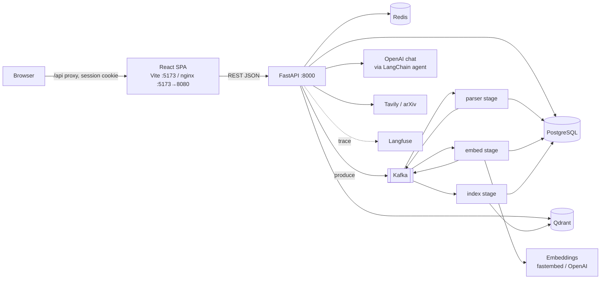

# System Architecture

> Owner: `system-architect` · Canonical design rationale: [`docs/RAG_ARCHITECTURE.md`](../RAG_ARCHITECTURE.md), [`docs/KAFKA_INGESTION.md`](../KAFKA_INGESTION.md), [`docs/EMBEDDING_AND_COLLECTIONS.md`](../EMBEDDING_AND_COLLECTIONS.md); code-level details: [`docs/ARCHITECTURE.md`](../ARCHITECTURE.md#backend).
> This doc holds only the overall map and principles. When the structure changes, update this doc and [DECISION_LOG.md](DECISION_LOG.md) together.

## Overall structure

The three stages run as three consumer groups (`parser-workers`, `embed-workers`, `index-workers`) inside one process, `workers.ingest_worker`.

## Components and responsibilities

| Component | Responsibility | Notes |
|---|---|---|
| Frontend (`frontend/`) | UI, React Query cache, API layer `src/lib/api/` | Same-origin via the Vite proxy (dev) or nginx (Docker) |
| API (`backend/app`) | Auth, collection/document/chat/usage APIs, agent execution, `/metrics` | Only produces to Kafka, never consumes |
| Ingest worker (`workers/ingest_worker.py`) | parser → embed → index, a 3-stage async pipeline | Must be running for documents to reach `INDEXED` |
| PostgreSQL | Users, sessions, CollectionMeta, chats, progress, logs, pricing | Alembic (`migrations/versions/` is gitignored) |
| Qdrant | Chunk vectors (dense + optional BM25 sparse), `document_id` in payload | Hybrid search with RRF fusion |
| Redis | Connected as a client singleton | Current usage to be confirmed from code |
| Kafka | Message bus between ingest stages | Topic design: RAG_ARCHITECTURE.md §4 |
| Monitoring (`monitoring-docker-compose.yaml`) | Prometheus, Grafana, exporters, cAdvisor, Loki + Alloy | Separate compose project on the infra network (D-012) |

Compose layout: `system-docker-compose.yaml` (infra, project `rag_chatbot_system`), `service-docker-compose.yaml` (api, frontend, ingest-worker; non-root), `monitoring-docker-compose.yaml`. Both service and monitoring join the external network `rag_chatbot_system_default`.

## Data flow

**Write (ingest):** `POST /collections/{name}/documents` → produce `documents.uploaded` → return 202 → parser stage (chunking) → embed stage (embedding) → index stage (Qdrant upsert) → status `INDEXED` + `DocumentManageLog`.

**Read (chat):** `POST /chats/{id}/messages` → ownership check → save user message → build the tool list per request → LangGraph agent `ainvoke` (tool calls may repeat, up to 20 steps) → final answer + citation parsing → save assistant message → token usage log. Non-streaming.

**Search:** embed the query with the collection's fixed embedding model → Qdrant: dense+sparse prefetch then RRF when sparse is configured, otherwise dense only → top-k 8.

## Main tables

`users`, `google_sessions`, `collection_meta`, `chats`, `chat_messages`, `document_progress_status`, `document_manage_logs`, `chat_usage_logs`, `agent_tool_call_logs`, `model_pricing`.

## Design principles

1. **Fixed layering:** endpoint → service → repository → client. Services and repositories are `@lru_cache` `get_*` singletons with constructor injection.
2. **One embedding model per collection:** ingestion and search both use the model fixed in `CollectionMeta`.
3. **Async writes, sync reads:** ingestion via Kafka, chat request-response (RAG_ARCHITECTURE.md §2.2).
4. **Exceptions raised in services/repositories, converted by a global handler:** no per-endpoint try/except.
5. **Logs only in the service/worker layer**; a per-request `api_call_id` is injected into every log line.
6. **Least privilege for agent tools:** no code execution, no free-form SQL ([DECISION_LOG.md](DECISION_LOG.md) D-003, D-004).
7. Optional external features (Tavily, Langfuse) silently disable without keys; not an error.

## Known structural constraints

See [KNOWN_ISSUES.md](KNOWN_ISSUES.md) (no compensating transaction, non-streaming, etc.).

Load-test scenarios and capacity hypotheses (DB pool / local embedding CPU): [`loadtest/SCENARIOS.md`](../../loadtest/SCENARIOS.md) (D-010).
